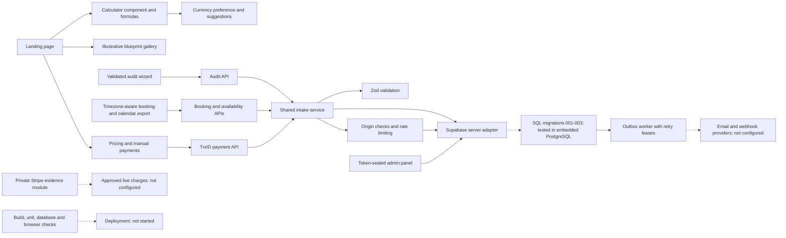

# OmniScale project memory

This folder preserves project context in reviewable repository files. It is not an external memory service.

| File                         | Purpose                                                   |
| ---------------------------- | --------------------------------------------------------- |
| [CURRENT.md](CURRENT.md)     | Current stage, implementation evidence, unresolved work   |
| [DECISIONS.md](DECISIONS.md) | Accepted and superseded product decisions                 |
| [BACKLOG.md](BACKLOG.md)     | Pending features (P0 MVP blockers → P2 polish) + non-goals |
| [graph.json](graph.json)     | Machine-readable modules, paths, status, and dependencies |
| [WORKFLOW.md](WORKFLOW.md)   | Resume, verification, and checkpoint procedure            |
| [TOOLS.md](TOOLS.md)         | Skill usage and MCP proposal policy                       |

## Codebase overview

Snapshot: 2026-10-15, HEAD `120b15d`, tree clean, no remote. Solid arrows describe implemented source relationships; dashed arrows describe external integration boundaries that still require live configuration. Planned nodes (D11–D14) are accepted but unbuilt — see BACKLOG.md.

The graph tracks feature boundaries rather than every import. Its `paths` list means files were observed; `missingPaths` means they were absent at inspection, not that the chosen filename is mandatory.

## Resume prompt

> Resume OmniScale from AGENTS.md and docs/project-memory/CURRENT.md. Reconcile the checkpoint with the current files, preserve accepted decisions, and continue the next unfinished authorized task. Update the tracker and dependency graph after verification. Propose an MCP connection only when an actual capability gap requires it.

Use this in the main project conversation. This memory-setup side conversation does not resume application development.
